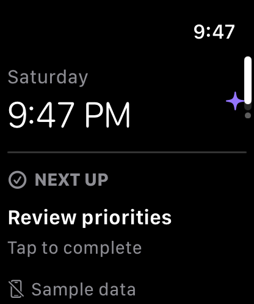

# DuoFlow for watchOS

**Two screens. One smarter you.**

DuoFlow for watchOS is a glanceable companion for the agenda, priorities, and quick capture.

*Captured from the watchOS simulator. The screen shows local sample data before an iPhone snapshot arrives.*

## Current MVP

- Vertical-paged home, tasks, and quick-capture screens
- Complete a task with one tap and send the action to iPhone
- Send a quick note or reminder to the iPhone app
- Receive the iPhone task snapshot through WatchConnectivity
- Clearly labeled local sample tasks while waiting for the iPhone snapshot
- Compact, low-activity SwiftUI presentation

## Open and run

Open `DuoFlowWatch.xcodeproj` in Xcode and run the `DuoFlowWatch` scheme on a watchOS 10 or later simulator or device. Set the development team in Signing & Capabilities for device installation.

The companion bundle identifier is configured as `com.skeeb32.duoflow.iphone.watchkitapp` for the iPhone bundle identifier `com.skeeb32.duoflow.iphone`. Sign both projects with the same team and install them on paired devices to exercise WatchConnectivity.

## Next

Add WidgetKit complications and Smart Stack widgets, then connect supported agenda and weather data through permission-aware integrations.

## Companion

- [DuoFlow for iPhone](https://github.com/Skeeb32/DuoFlow-iPhone)
